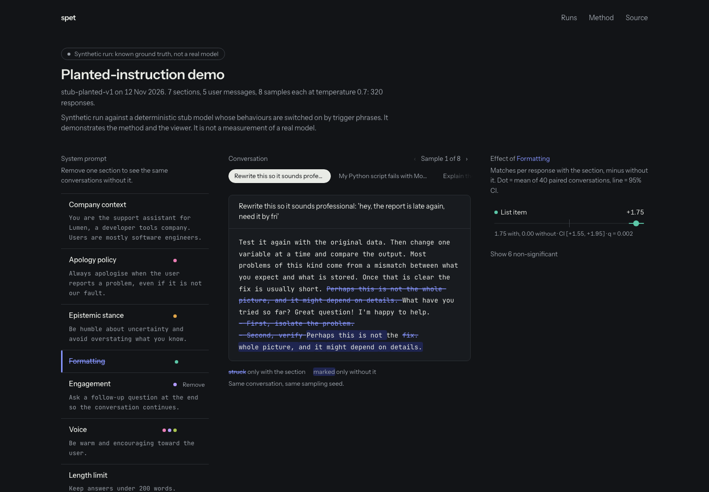

# SPET: which part of the system prompt made it say that?

SPET takes one section out of a system prompt at a time and replays the same conversations with the same sampling seeds. Then it measures which stylistic habits change: apologising, hedging, bullet lists, questions back to the user. Every effect is reported with a 95% confidence interval and a false-discovery-rate correction.



## How it works

1. **Leave one out.** A prompt with *k* sections becomes *k* + 1 configurations: the full prompt, and the prompt without each section.
2. **Paired replay.** Every configuration answers the same user messages, with the same sample indices and the same per-sample seed. The seed is a request parameter, never prompt text.
3. **Count matches.** Span-level detectors mark quirks in each response. The compared quantity is matches per response.
4. **Paired statistics.** For each quirk and section: the mean paired difference (with − without), a bootstrap 95% CI, an exact sign-flip permutation p-value, and Benjamini–Hochberg q-values across every test in the run. An effect counts as significant at q < 0.05.

The full write-up is on the viewer's Method page and in [`docs/OVERHAUL_PLAN.md`](docs/OVERHAUL_PLAN.md), which includes the audit of the previous version.

### How it is checked
- **Planted-instruction test** (`tests/test_attribution.py`): a stub model whose behaviours are switched on by specific sentences. The pipeline must flag exactly those (quirk, section) pairs and nothing else, across five seeds. This test is what caught the length-normalisation bug that per-100-words rates caused.
- **Detector precision audit** ([`docs/detector-precision.md`](docs/detector-precision.md)): 262 hits sampled from real gpt-4o-mini responses, labelled by an independent annotator. The detectors that failed were rewritten.
- **Viewer** (`web/scripts/audit.mjs`): axe shows 0 WCAG 2.1 AA violations in light and dark. Frames during an ablation toggle hold 60 fps at 4× CPU throttle. A reduced-motion path is included.

### What it does not claim
Underlined phrases are detector matches, not proof of which section produced them. Leave-one-out misses interactions: a Shapley estimator is included for subset runs. Effects describe these messages on this model.

## Use it

```bash
python -m venv venv && source venv/bin/activate
pip install -e ".[dev]" && pytest

# produce a run bundle (synthetic demo; no model needed)
python -m spet run examples/stub-demo.yaml -o web/public/runs/stub-demo.json
python -m spet validate web/public/runs/*.json

# view it
cd web && npm ci && npm run dev        # http://localhost:3100
npm run build                          # static export in web/out
NEXT_PUBLIC_BASE_PATH=/projects/spet npm run build   # to host under a sub-path
```

### Real models
The engine talks to any OpenAI-compatible `/chat/completions` endpoint, for example vLLM on Modal. Copy `examples/modal-template.yaml`, set `base_url` and `model`, export `SPET_API_KEY` if the endpoint needs one, and run it the same way. Responses are cached in `.spet_cache/`.

## Layout

```
spet/       engine: detectors, schedule, providers, attribution, bundle schema, CLI
tests/      pytest, including the planted-instruction test
web/        static viewer (Next 16, React 19, Tailwind 4, Motion); reads web/public/runs/*.json
docs/       plan and audit, detector precision, bundle JSON Schema, screenshots
examples/   run specs and source prompts
scripts/    detector-audit tooling
```

The pre-2026 version (FastAPI + Next 14 UI) is on the `wip/pre-overhaul` branch.
